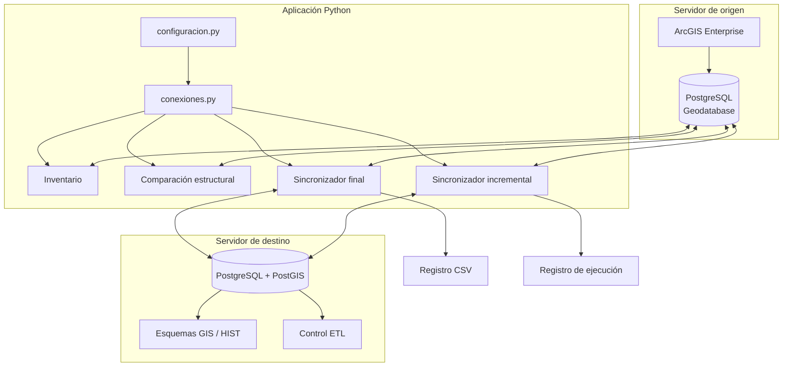
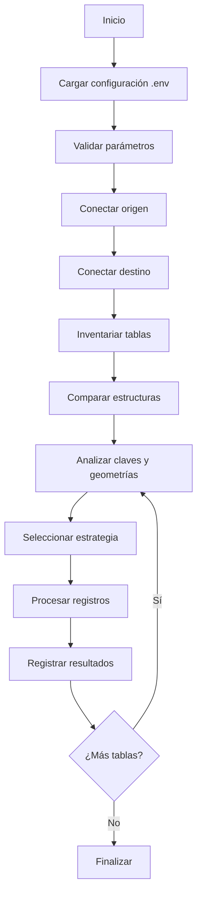
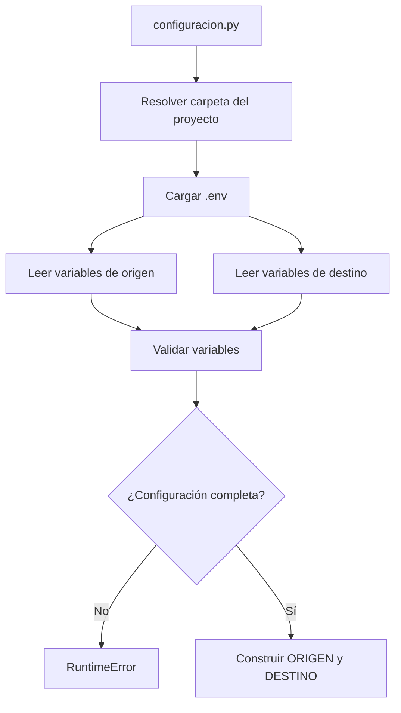
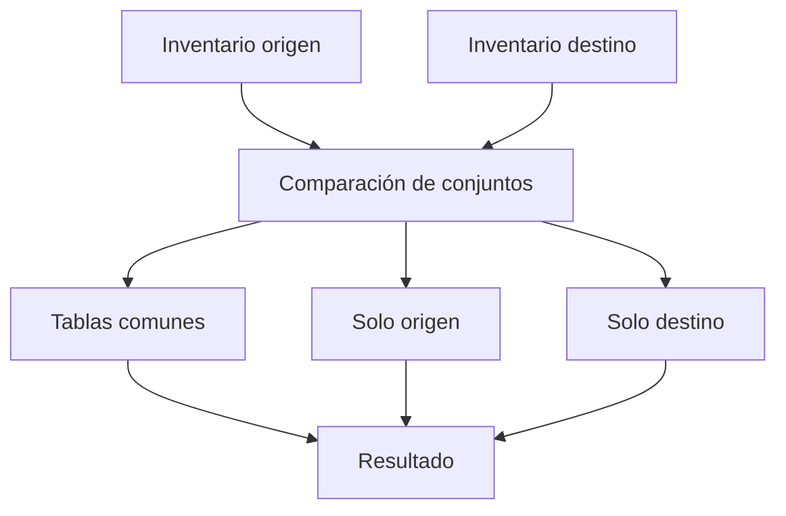
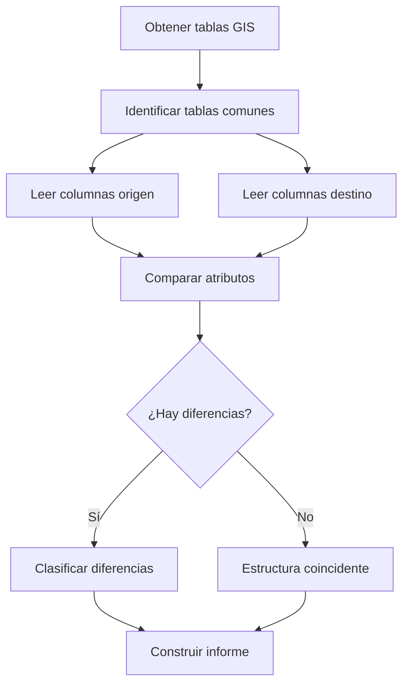
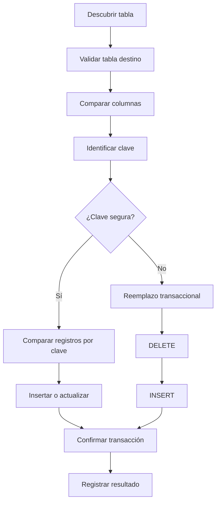
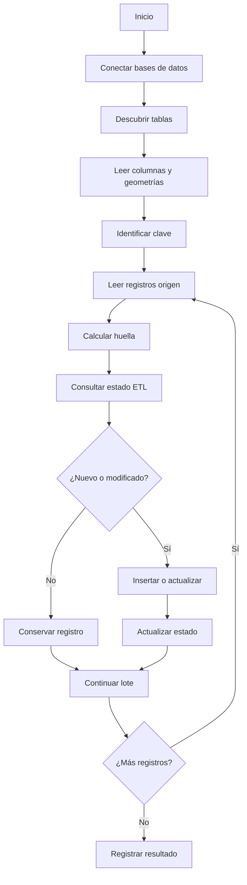
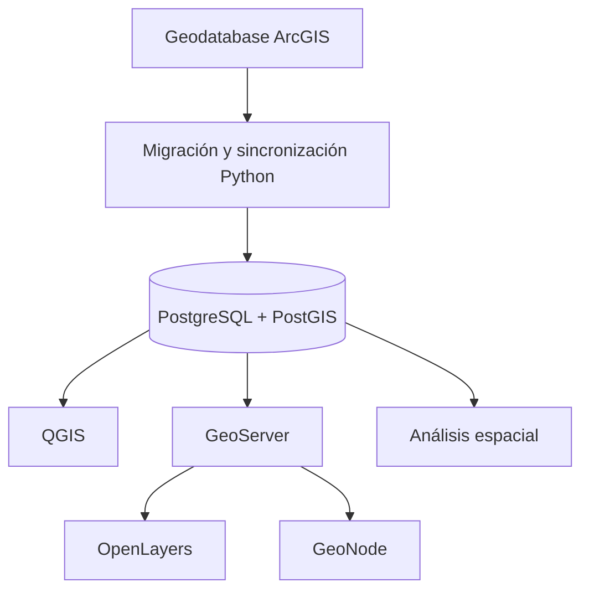

# Migración y sincronización de geodatabases ArcGIS hacia PostgreSQL/PostGIS

<p align="center">
  <strong>Plataforma de ingeniería de datos geoespaciales, inventario, análisis estructural y sincronización ETL</strong>
</p>

<p align="center">
  
  
  
  
  
</p>

---

## 1. Introducción

Este proyecto implementa herramientas en Python para apoyar la migración, inventario, comparación estructural y sincronización de información geográfica almacenada en geodatabases ArcGIS sobre PostgreSQL hacia una plataforma PostgreSQL con PostGIS.

La solución busca automatizar el traslado de datos, reducir actividades manuales y facilitar la validación de la información entre dos entornos de bases de datos.

El proyecto contempla dos motores de sincronización, módulos de análisis estructural e inventario y una configuración centralizada para administrar las conexiones.

### Objetivos

- Centralizar las conexiones PostgreSQL.
- Proteger las credenciales mediante variables de entorno.
- Inventariar tablas de los esquemas `gis` e `hist`.
- Comparar estructuras y metadatos de columnas.
- Identificar claves primarias y restricciones únicas.
- Sincronizar registros mediante estrategias basadas en claves.
- Procesar tablas sin claves seguras mediante reemplazo transaccional cuando corresponda.
- Tratar información geométrica.
- Registrar resultados y estados de ejecución.
- Facilitar reprocesamientos y diagnósticos.

> El proyecto está orientado a la migración y sincronización de tablas y datos. No garantiza por sí solo la reconstrucción integral de todos los componentes internos de una geodatabase corporativa ArcGIS.

---

## 2. Arquitectura de la solución

La arquitectura está organizada en cuatro capas:

1. Configuración.
2. Conectividad.
3. Inventario y análisis estructural.
4. Sincronización y registro.

### 2.1 Arquitectura general



### 2.2 Flujo de procesamiento



---

## 3. Tecnologías

| Tecnología | Utilización |
|---|---|
| Python | Desarrollo de la solución |
| PostgreSQL | Base de datos origen y destino |
| PostGIS | Administración de información espacial |
| Psycopg 3 | Conectividad PostgreSQL |
| python-dotenv | Variables de entorno |
| SQL | Consultas y operaciones de datos |
| CSV | Registro de resultados |
| PowerShell | Ejecución en Windows |
| Git | Control de versiones |

### Dependencias

Archivo `requirements.txt`:

```text
psycopg[binary]>=3.3.9
python-dotenv>=1.2.1
```

---

## 4. Estructura del proyecto

```text
MigracionArcGISPostGIS/
│
├── .env
├── .env.example
├── .gitignore
├── README.md
├── requirements.txt
│
├── configuracion.py
├── conexiones.py
├── probar_conexiones.py
│
├── sincronizacion_arcgis_postgis_final.py
├── sincronizacion_arcgis_postgis_incremental.py
│
└── sincronizador/
    ├── __init__.py
    ├── conexiones.py
    ├── estructura.py
    └── inventario.py
```

| Archivo | Responsabilidad |
|---|---|
| `configuracion.py` | Configuración central |
| `conexiones.py` | Conexiones a PostgreSQL |
| `probar_conexiones.py` | Prueba de conectividad |
| `sincronizador/inventario.py` | Inventario de tablas |
| `sincronizador/estructura.py` | Comparación de columnas |
| `sincronizador/conexiones.py` | Compatibilidad de conexiones |
| `sincronizacion_arcgis_postgis_final.py` | Sincronización final |
| `sincronizacion_arcgis_postgis_incremental.py` | Sincronización incremental |

---

## 5. Configuración centralizada

El módulo `configuracion.py` centraliza la lectura de parámetros de conexión.

Utiliza:

- `os` para acceder a variables de entorno.
- `pathlib` para resolver la ubicación del proyecto.
- `python-dotenv` para cargar el archivo `.env`.

La función `obtener_configuracion(prefijo)`:

1. Construye los nombres de variables.
2. Comprueba que estén definidas.
3. Identifica las variables faltantes.
4. Convierte el puerto a entero.
5. Devuelve un diccionario compatible con Psycopg.

### Variables de entorno

| Variable | Descripción |
|---|---|
| `PG_ORIGEN_HOST` | Host de origen |
| `PG_ORIGEN_PORT` | Puerto de origen |
| `PG_ORIGEN_DATABASE` | Base de datos de origen |
| `PG_ORIGEN_USER` | Usuario de origen |
| `PG_ORIGEN_PASSWORD` | Contraseña de origen |
| `PG_DESTINO_HOST` | Host de destino |
| `PG_DESTINO_PORT` | Puerto de destino |
| `PG_DESTINO_DATABASE` | Base de datos de destino |
| `PG_DESTINO_USER` | Usuario de destino |
| `PG_DESTINO_PASSWORD` | Contraseña de destino |

### Flujo de configuración



### Configuración local

Crear el archivo:

```powershell
Copy-Item .env.example .env
```

Ejemplo de contenido con valores ficticios:

```dotenv
PG_ORIGEN_HOST=servidor_origen
PG_ORIGEN_PORT=5432
PG_ORIGEN_DATABASE=geodatabase_origen
PG_ORIGEN_USER=usuario_origen
PG_ORIGEN_PASSWORD=contraseña_origen

PG_DESTINO_HOST=servidor_destino
PG_DESTINO_PORT=5432
PG_DESTINO_DATABASE=geodatabase_destino
PG_DESTINO_USER=usuario_destino
PG_DESTINO_PASSWORD=contraseña_destino
```

No publicar el archivo `.env`.

---

## 6. Conectividad PostgreSQL

Archivo: `conexiones.py`.

Utiliza Psycopg 3 para establecer conexiones independientes.

### Funciones

| Función | Descripción |
|---|---|
| `conectar_origen()` | Conecta a la base de datos de origen |
| `conectar_destino()` | Conecta a la base de datos de destino |
| `probar_conexiones()` | Comprueba ambas conexiones |

Las conexiones configuran:

- `connect_timeout`.
- `application_name`.
- Parámetros de autenticación centralizados.

El nombre de aplicación permite identificar las sesiones en PostgreSQL.

### Prueba de conectividad

```powershell
python .\probar_conexiones.py
```

La prueba consulta:

```sql
SELECT
    current_database(),
    current_user,
    version();
```

---

## 7. Inventario de tablas

Archivo: `sincronizador/inventario.py`.

El inventario identifica tablas físicas de los esquemas:

- `gis`
- `hist`

La consulta se realiza mediante `information_schema.tables`.

### Funciones

| Función | Responsabilidad |
|---|---|
| `obtener_tablas()` | Recuperar las tablas |
| `comparar_inventario()` | Comparar origen y destino |

### Clasificación

| Resultado | Significado |
|---|---|
| `solo_origen` | Tabla presente únicamente en origen |
| `solo_destino` | Tabla presente únicamente en destino |
| `comunes` | Tabla existente en ambos |
| `total_origen` | Cantidad de tablas de origen |
| `total_destino` | Cantidad de tablas de destino |

### Diagrama



Este módulo es de solo lectura.

---

## 8. Comparación estructural

Archivo: `sincronizador/estructura.py`.

Compara las columnas de las tablas comunes del esquema `gis`.

### Funciones

- `obtener_tablas()`
- `obtener_columnas()`
- `comparar_estructuras()`

### Metadatos comparados

| Atributo | Descripción |
|---|---|
| `column_name` | Nombre |
| `ordinal_position` | Posición |
| `data_type` | Tipo de dato |
| `udt_name` | Tipo interno |
| `character_maximum_length` | Longitud |
| `numeric_precision` | Precisión |
| `numeric_scale` | Escala |
| `is_nullable` | Nulabilidad |
| `is_identity` | Indicador de identidad |
| `identity_generation` | Generación de identidad |

### Tipos de diferencias

- `FALTA_EN_DESTINO`
- `ADICIONAL_EN_DESTINO`
- `ESTRUCTURA_DIFERENTE`



El módulo no realiza modificaciones. Tampoco representa una comparación integral de índices, restricciones, funciones, secuencias, vistas y todos los objetos de ArcGIS.

---

## 9. Sincronizador final

Archivo: `sincronizacion_arcgis_postgis_final.py`.

Es el motor de sincronización que descubre tablas, valida columnas, analiza claves y procesa registros.

### Parámetros principales

| Parámetro | Valor |
|---|---|
| Esquemas | `gis`, `hist` |
| Lote predeterminado | 500 |
| Reintentos | 3 |
| Espera entre reintentos | 20 segundos |
| Log | `sincronizacion_arcgis_postgis_resultado.csv` |

### Funciones internas

| Función | Responsabilidad |
|---|---|
| `connect()` | Conectar a PostgreSQL |
| `qname()` | Construir identificadores SQL |
| `columns()` | Consultar columnas |
| `discover()` | Descubrir tablas |
| `geom_info()` | Consultar información geométrica |
| `simple_key()` | Identificar clave segura |
| `ensure_state()` | Preparar estado |
| `state_read()` | Leer estado |
| `safe()` | Normalizar valores |
| `row_hash()` | Calcular huella |
| `source_select()` | Construir consulta de origen |
| `insert_stmt()` | Construir inserción |
| `params_for()` | Preparar parámetros |
| `target_exists()` | Verificar tabla destino |
| `validate()` | Validar compatibilidad |
| `sync_one()` | Sincronizar tabla |
| `latest_ok()` | Consultar resultados previos |
| `log()` | Registrar resultado |
| `main()` | Coordinar ejecución |

### Selección de estrategia



### Tablas con claves

Cuando existe una clave primaria o única compatible, se utiliza para identificar registros.

El cálculo de huellas permite comparar el contenido de las filas y apoyar la identificación de modificaciones.

### Tablas sin claves seguras

Cuando no se encuentra una clave segura, el sincronizador contempla una estrategia transaccional de eliminación y reinserción.

Esta estrategia:

1. Prepara la operación.
2. Elimina los registros existentes en destino.
3. Inserta los registros recuperados del origen.
4. Confirma la transacción si termina correctamente.

**Advertencia:** esta operación reemplaza los datos de la tabla en destino. Requiere respaldo y validación previa. No debe utilizarse indiscriminadamente sobre tablas que reciben modificaciones independientes en destino.

### Geometrías

El programa contempla tratamiento de geometrías mediante funciones SDE y PostGIS.

Flujo conceptual:

```sql
sde.st_astext(geometria)
```

Conversión en destino:

```sql
ST_GeomFromText(texto_geometrico, srid)
```

El tratamiento depende de los tipos espaciales disponibles y del SRID correspondiente.

Convertir geometrías no implica transformar automáticamente sus coordenadas. Debe verificarse el sistema de referencia.

### Reintentos y registro

El proceso contempla reintentos de tabla y registra resultados en CSV.

La información registrada contempla:

- Esquema.
- Tabla.
- Estado.
- Registros procesados.
- Inserciones.
- Actualizaciones.
- Duración.
- Mensaje asociado.

### Opciones de ejecución

Consultar:

```powershell
python .\sincronizacion_arcgis_postgis_final.py --help
```

Opciones:

| Argumento | Descripción |
|---|---|
| `--batch-size` | Tamaño del lote |
| `--log` | Archivo de resultados |
| `--reprocesar` | Forzar reprocesamiento |
| `--solo` | Limitar tablas seleccionadas |

Ejemplo:

```powershell
python .\sincronizacion_arcgis_postgis_final.py --batch-size 500
```

Ejemplo con log:

```powershell
python .\sincronizacion_arcgis_postgis_final.py --batch-size 500 --log resultados.csv
```

Ejemplo de reprocesamiento:

```powershell
python .\sincronizacion_arcgis_postgis_final.py --reprocesar
```

---

## 10. Sincronizador incremental

Archivo: `sincronizacion_arcgis_postgis_incremental.py`.

Este motor utiliza claves, huellas de registros y almacenamiento de estado para apoyar ejecuciones sucesivas.

### Parámetros

| Parámetro | Valor |
|---|---|
| Esquemas | `gis`, `hist` |
| Esquema de control | `etl` |
| Tabla de estado | `arcgis_postgis_sync_state` |
| Lote | 1000 |
| Log | `sincronizacion_arcgis_postgis_resultado.csv` |

### Funciones principales

| Función | Responsabilidad |
|---|---|
| `connect()` | Conexión |
| `ident()` | Identificadores |
| `json_safe()` | Normalización |
| `digest_row()` | Huella de fila |
| `log_result()` | Registro |
| `discover_tables()` | Descubrimiento |
| `get_columns()` | Columnas |
| `get_safe_key()` | Claves |
| `get_geometry_info()` | Geometrías |
| `ensure_state_table()` | Preparación del control |
| `target_exists()` | Existencia de tabla |
| `read_state()` | Lectura del estado |
| `state_upsert()` | Actualización del estado |
| `build_select()` | Consulta origen |
| `build_upsert()` | Inserción/actualización |
| `sync_table()` | Sincronización |
| `main()` | Coordinación |

### Control ETL

El programa utiliza:

```text
etl.arcgis_postgis_sync_state
```

Esta tabla almacena información de seguimiento de la sincronización.

Debe protegerse frente a modificaciones manuales que puedan afectar la continuidad del proceso.

### Flujo incremental conceptual



La propagación de eliminaciones del origen requiere un mecanismo explícito de detección y conciliación. No debe suponerse que el proceso elimina automáticamente todos los registros ausentes.

---

## 11. Comparación de los motores

| Característica | Final | Incremental |
|---|---|---|
| Esquemas | GIS / HIST | GIS / HIST |
| Lote predeterminado | 500 | 1000 |
| Análisis de claves | Sí | Sí |
| Huellas | Sí | Sí |
| Reemplazo sin clave | Sí | Validar implementación |
| Reintentos | 3 | Según implementación |
| Control de estado | Estado y log | Tabla ETL |
| Registro | CSV | CSV |

Los motores son independientes. No deben ejecutarse simultáneamente sobre las mismas tablas sin coordinación.

---

## 12. Rendimiento y optimización

El procesamiento por lotes limita la cantidad de registros manejados en cada iteración.

Factores que afectan el rendimiento:

- Latencia de red.
- Ancho de banda.
- Tamaño de tablas.
- Número de columnas.
- Tamaño de geometrías.
- Índices y restricciones.
- Memoria y CPU.
- Concurrencia de PostgreSQL.
- Tamaño de los lotes.

Un lote mayor puede reducir iteraciones, pero incrementar memoria y duración de transacciones.

Un lote menor puede reducir el trabajo por operación, pero aumentar viajes al servidor.

La selección debe basarse en pruebas representativas.

---

## 13. Seguridad

Buenas prácticas:

1. Mantener `.env` fuera de Git.
2. Publicar únicamente `.env.example`.
3. No escribir contraseñas en código.
4. Utilizar cuentas con permisos mínimos.
5. Restringir accesos de red.
6. Utilizar SSL cuando corresponda.
7. Realizar respaldos antes de modificar datos.
8. No publicar direcciones internas.
9. Revisar los logs antes de compartirlos.

### Permisos por entorno

| Entorno | Permisos |
|---|---|
| Origen | Lectura de esquemas y datos |
| Destino | Lectura y escritura necesarias |
| Esquema ETL | Administración del estado |
| PostGIS | Acceso a tipos y funciones espaciales |

---

## 14. Instalación

### Requisitos

- Python 3.10 o superior.
- PostgreSQL de origen y destino.
- PostGIS en destino.
- Acceso de red a ambos servidores.
- Permisos adecuados.

### Clonar

```powershell
git clone https://github.com/olimpop/MigracionArcGISPostGIS.git
cd .\MigracionArcGISPostGIS
```

### Crear entorno virtual

```powershell
python -m venv .venv
.\.venv\Scripts\Activate.ps1
```

### Instalar dependencias

```powershell
python -m pip install --upgrade pip
python -m pip install -r requirements.txt
```

### Configurar entorno

```powershell
Copy-Item .env.example .env
notepad .env
```

### Probar conexiones

```powershell
python .\probar_conexiones.py
```

### Consultar sincronizador

```powershell
python .\sincronizacion_arcgis_postgis_final.py --help
```

Antes de procesar producción, realizar una prueba con un conjunto reducido y revisar sus resultados.

---

## 15. Validación posterior

La finalización de un proceso no garantiza equivalencia completa entre bases de datos.

Validaciones recomendadas:

| Validación | Objetivo |
|---|---|
| Inventario | Existencia de tablas |
| Estructura | Compatibilidad de columnas |
| Conteos | Volumen de registros |
| Claves | Integridad |
| Nulabilidad | Calidad de datos |
| Geometrías | Validez espacial |
| SRID | Referencia espacial |
| Índices | Rendimiento |
| Relaciones | Dependencias |
| Adjuntos | Asociación de archivos |
| Dominios | Reglas de valores |

Consulta de columnas geométricas registradas en PostGIS:

```sql
SELECT
    f_table_schema,
    f_table_name,
    f_geometry_column,
    coord_dimension,
    srid,
    type
FROM geometry_columns
ORDER BY f_table_schema, f_table_name;
```

---

## 16. Integración con herramientas GIS

La arquitectura de destino permite integrar los datos con herramientas de análisis y publicación geográfica.



QGIS, GeoServer, OpenLayers y GeoNode representan posibilidades de integración. No se consideran componentes implementados dentro de este repositorio.

---

## 17. Consideraciones de geodatabase ArcGIS

Una geodatabase corporativa puede contener:

- Clases de entidad.
- Datasets.
- Tablas de sistema.
- Dominios codificados.
- Relaciones.
- Adjuntos.
- Metadatos.
- Referencias espaciales.
- Reglas propias de ArcGIS.
- Estructuras internas de versionamiento.

La transferencia de tablas no garantiza la conservación automática de todos estos elementos.

Cada componente requiere análisis y validación específicos.

---

## 18. Solución de problemas

### Variables faltantes

- Verificar existencia de `.env`.
- Revisar nombres de variables.
- Comprobar valores vacíos.
- Confirmar codificación.

### Errores de conexión

- Verificar host y puerto.
- Comprobar firewall.
- Revisar `pg_hba.conf`.
- Validar credenciales y permisos.
- Comprobar certificados SSL.

### Diferencias estructurales

- Revisar tipos.
- Revisar longitudes.
- Revisar precisión y escala.
- Revisar nulabilidad.
- Revisar columnas faltantes.

### Errores geométricos

- Revisar tipo espacial.
- Revisar funciones SDE.
- Validar SRID.
- Revisar geometrías inválidas.
- Confirmar compatibilidad PostGIS.

### Errores de sincronización

- Revisar archivo CSV.
- Revisar permisos.
- Validar restricciones.
- Revisar transacciones.
- Ajustar lote.
- Comprobar disponibilidad de servidores.

---

## 19. Recomendaciones operativas

### Antes de ejecutar

- Comprobar conectividad.
- Verificar respaldo.
- Revisar tablas seleccionadas.
- Validar claves.
- Evaluar tablas sin clave segura.
- Revisar espacio disponible.
- Confirmar capacidad del destino.

### Después de ejecutar

- Revisar CSV.
- Identificar tablas fallidas.
- Comparar conteos.
- Validar geometrías.
- Revisar estado ETL.
- Documentar diferencias.

---

## 20. Limitaciones conocidas

- No reconstruye automáticamente todos los objetos internos de ArcGIS.
- La comparación estructural actual se concentra en columnas de tablas del esquema `gis`.
- El inventario contempla `gis` e `hist`.
- Las tablas sin clave segura requieren tratamiento especial.
- La propagación de eliminaciones necesita validación específica.
- La equivalencia espacial depende de tipos y SRID.
- La sincronización debe validarse funcionalmente antes de producción.

---

## 21. Evolución del proyecto

Líneas de trabajo futuras:

1. Comparación integral de índices y restricciones.
2. Detección controlada de eliminaciones.
3. Migración de dominios y relaciones.
4. Migración de adjuntos.
5. Validación avanzada de geometrías.
6. Informes de calidad de datos.
7. Métricas de rendimiento por tabla.
8. Pruebas automatizadas.
9. Ejecución programada.
10. Integración con QGIS y GeoServer.

---

## 22. Licencia

La licencia del proyecto debe definirse antes de distribuir o reutilizar públicamente el código.

---

## 23. Autor y repositorio

**Proyecto:** Migración y sincronización ArcGIS PostgreSQL a PostgreSQL/PostGIS.

**Repositorio:**

https://github.com/olimpop/MigracionArcGISPostGIS

Herramienta de ingeniería de datos geoespaciales, automatización ETL y administración de bases de datos PostgreSQL/PostGIS.

---